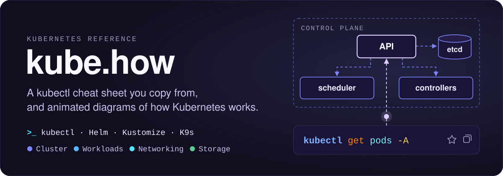
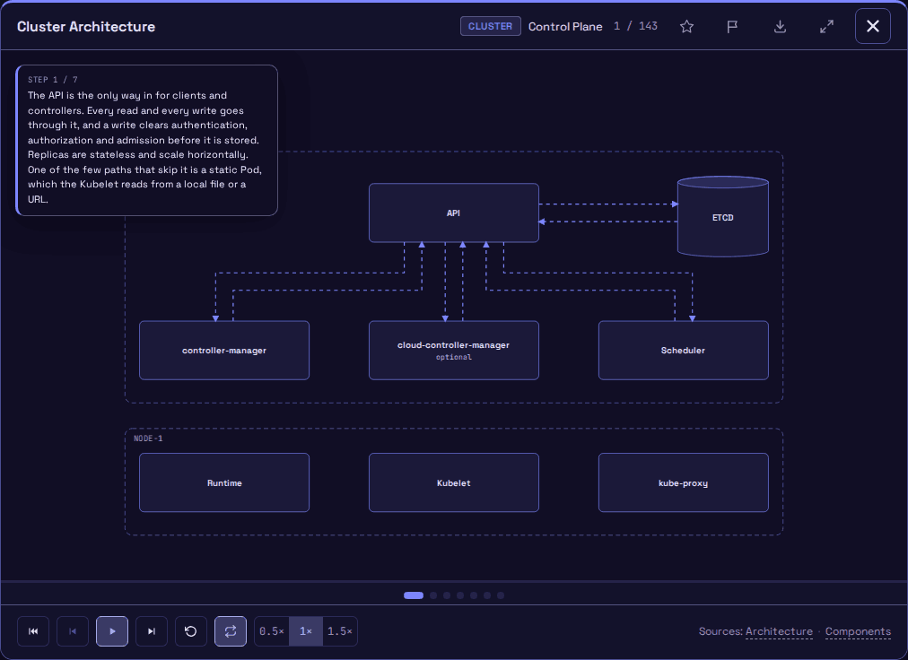
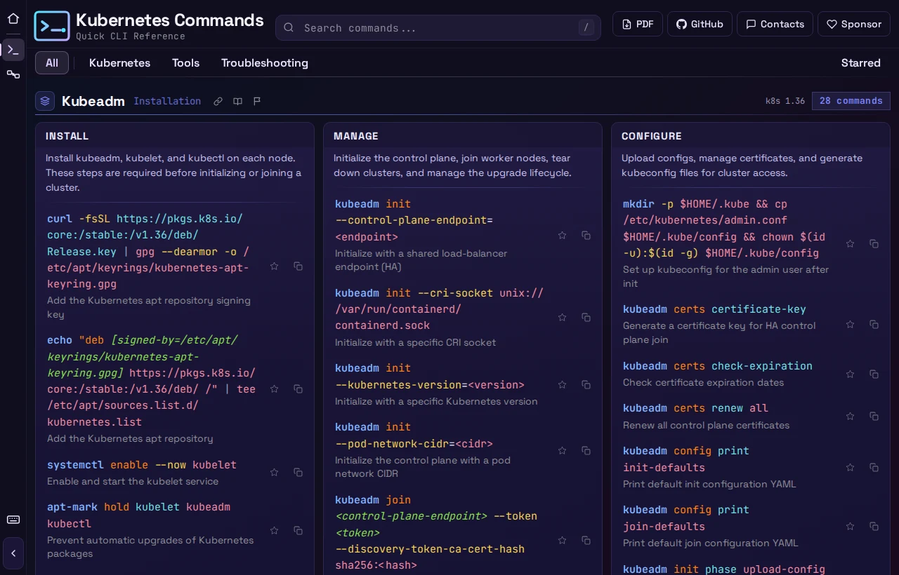

<p align="center">
  <a href="https://kube.how/"></a>
</p>

<p align="center">
  <a href="https://kube.how/"><b>Open kube.how</b></a>
  &nbsp;·&nbsp; <a href="https://kube.how/cli/">Commands</a>
  &nbsp;·&nbsp; <a href="https://kube.how/diagrams/">Diagrams</a>
  &nbsp;·&nbsp; <a href="./cli/README.md">Commands guide</a>
  &nbsp;·&nbsp; <a href="./diagrams/README.md">Diagrams guide</a>
  &nbsp;·&nbsp; <a href="./README.ru.md">Русский</a>
</p>

A fast, searchable web reference for everyone who works with Kubernetes day to day: a command cheat sheet and a library of animated architecture diagrams. No login, no ads, no cookies, no install, just open the page and use it. The interface, the descriptions and the diagram narration are in English or Russian, one button away.

<p align="center">
  
</p>
<p align="center"><sub>The Cluster Architecture diagram, recorded frame by frame from the live site.</sub></p>

## What is inside

One static site, three apps:

| Path | App | What it is |
|---|---|---|
| [`/`](https://kube.how/) | **Hub** | One-viewport landing page: two entry panels with live counts over an aurora background and a canvas packet graph |
| [`/cli/`](https://kube.how/cli/) | **Commands** | Searchable kubectl / Helm / Kustomize / K9s cheat sheet, 886 commands, copy + star |
| [`/diagrams/`](https://kube.how/diagrams/) | **Diagrams** | Grid of 143 animated SVG diagrams: click a card and a step-by-step animation explains the mechanism |

### Commands

<p align="center">
  
</p>

886 commands across eight categories, from installing a cluster to debugging one: kubectl, kubeadm, k3s, k3d, KinD, Minikube, Helm, Kustomize and K9s. Click a command to copy it, star the ones you keep coming back to, press `/` to search everything at once. Every section also has its own page, for example [kube.how/cli/section/pod/](https://kube.how/cli/section/pod/).

**[Read the Commands guide →](./cli/README.md)**

### Diagrams

143 animated diagrams of how Kubernetes actually works internally, in four categories: Cluster, Workloads, Networking and Storage. Each card opens a dialog that plays the mechanism step by step, with a narration panel explaining what moves and why, and links to the Kubernetes documentation it is based on. Every diagram also has its own readable page, for example [kube.how/diagrams/card/cluster-architecture/](https://kube.how/diagrams/card/cluster-architecture/).

**[Read the Diagrams guide →](./diagrams/README.md)**

## How it is built

- **No framework, no bundler, no npm at runtime.** Plain HTML, CSS and ES modules that the browser loads directly. The only external requests are Google Fonts and the cookieless Cloudflare Web Analytics beacon.
- **Diagrams are hand-built SVG** moved by the Web Animations API inside a native `<dialog>`. No diagram library, no canvas, no WebGL.
- **A static page for every card and every section.** Both apps route by `#`, which search engines ignore, so `tools/pages/build.mjs` writes one HTML page per diagram and per command section, plus `sitemap.xml` and `llms.txt`, from the same modules the apps load.
- **A browser walks every step.** `diagrams/test/` runs on the Node test runner with Playwright: unit tests over the catalogue and the prose, and render tests that play every step of every diagram. CI runs it before each deploy.

## Run it locally

Any static file server works. Serve the repository root, because links between pages are root-absolute. The generator and the tests need Node 22 or newer (CI runs Node 24):

```bash
python3 -m http.server 8888 --bind 0.0.0.0
```

Open [localhost:8888](http://localhost:8888) for the hub, `/cli/` for commands and `/diagrams/` for diagrams. The per-card and per-section static pages are build output, so run `node tools/pages/build.mjs` once if you want them too.

### Docker

The image serves the whole site with nginx. Generate the static pages first, the build refuses to run without them:

```bash
node tools/pages/build.mjs
docker compose up -d --build
```

Open [localhost:8080](http://localhost:8080). Run the same `docker compose up -d --build` again after a change. Without Compose:

```bash
docker build -t kube-cheatsheet .
docker run -d --name kube-cheatsheet -p 8080:80 kube-cheatsheet
```

## Repository layout

Each app has its own guide: [`cli/README.md`](./cli/README.md) and [`diagrams/README.md`](./diagrams/README.md).

```
index.html               hub landing page, self-contained
404.html                 custom not-found page
cli/                     Commands app and the chrome every page shares
diagrams/                Diagrams app, its catalogue and its test suite
images/                  social previews and the home-screen icon
scheme/                  redirect from the old /scheme/ address to /diagrams/
tools/pages/build.mjs    writes the static pages, sitemap.xml and llms.txt
tools/deploy/            stages and version-stamps the site for GitHub Pages
tools/smoke/site.mjs     drives every key, button and view in a browser
configs/nginx.conf       nginx config for the Docker image
compose.yaml             local Docker setup
.github/                 workflows, Dependabot and the README media (never shipped)
```

## Contributing

Spotted a wrong flag, a stale command or a diagram that says something the docs do not? Every command section and every diagram has a flag button that opens a prefilled GitHub issue, and pull requests are welcome.

- **Commands** live in one file, `cli/js/data.js`. See [Adding a command](./cli/README.md#adding-a-command).
- **Diagrams** live in one folder per category. See [Adding a diagram](./diagrams/README.md#adding-a-diagram).
- After either, run `node tools/pages/build.mjs` to refresh the static pages, then the tests: `cd diagrams/test && npm ci && npm run test:unit`.

## License

MIT © [Ivan Medaev](https://t.me/opengrad). Not affiliated with the CNCF or the Kubernetes project.
