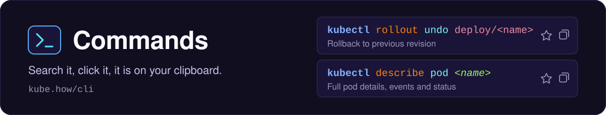

<p align="center">
  <a href="https://kube.how/cli/"></a>
</p>

The command half of [kube.how](https://kube.how/): kubectl, kubeadm, k3s, k3d, KinD, Minikube, Helm, Kustomize and K9s commands, each with a short plain-English description, a one-click copy button and a star. Live at **[kube.how/cli](https://kube.how/cli/)**.

[← Back to the main README](../README.md)

<p align="center">
  
</p>

## What it covers

| Category | Sections |
|---|---|
| **Installation** | Kubeadm, k3s, k3d, KinD, Minikube |
| **Cluster** | Cluster Health, Nodes, Custom Resources, Contexts |
| **Workloads** | Pods, Deployments, StatefulSets, DaemonSets, Services, ConfigMaps & Secrets, Jobs & CronJobs, Volumes, Networking, RBAC, Namespaces |
| **Helm** | Releases, Charts |
| **Kustomize** | Manage, Edit |
| **K9s** | CLI & Launch, UI Shortcuts |
| **Debug K8s** | Installation, Cluster, Network, Storage, Resources, Scheduling |
| **Debug Tools** | Helm, Kustomize, K9s |

Every section has its own static page, for example [kube.how/cli/section/pod/](https://kube.how/cli/section/pod/), and [kube.how/cli/section/](https://kube.how/cli/section/) lists them all. Helm, Kustomize and K9s, whose commands span several sections, get one page each as well.

## How to use it

- **Click any command** to copy it to the clipboard.
- **Star a command** with the icon left of the copy button to keep it in your Starred view (top right of the nav). Stars live in your browser only, nothing leaves the page.
- **Search** filters across every command and description at once, and keeps working inside the Starred view.
- **New commands** since your last visit carry a `NEW` badge until you copy them, and each section shows how many it has.
- **Section buttons** beside every section title copy a link to the section, open its official documentation, or report a wrong flag or a stale command through a prefilled GitHub issue.
- **Navigation**: the top row switches between groups, the rows below narrow it to a category and a section.
- **Deep links**: the address follows you, so `kube.how/cli/#helm` or `kube.how/cli/#starred` open exactly that view.
- **Save as PDF**: the PDF button in the header lays every command out as a printable book.

### Keyboard

| Key | Action |
|---|---|
| `/` | Jump to search |
| `Esc` | Clear the search |
| `?` | Show every shortcut |

The shortcuts work on a non-Latin keyboard layout too.

## How it is built

`/cli/` is one HTML page and a handful of ES modules, with no build step. It also hosts the chrome that every page on the site shares.

```
cli/
  index.html          the page
  js/app.js           renders the sections, search, stars, deep links and the PDF book
  js/data.js          every command: the one file to edit for content
  js/contacts.js      GitHub, Contacts and Sponsor buttons (optional: delete it to drop them)
  js/lib/commands.js  the syntax highlighter and the order commands show in a group
  js/lib/chrome.js    shared header, dropdowns and logo alignment, used by every page
  js/lib/sidebar.js   shared left sidebar
  js/lib/keys.js      shared shortcuts sheet
  js/lib/fresh.js     shared "new since your last visit" badges
  css/chrome.css      shared chrome styles, linked by every page before its own stylesheet
  css/styles.css      tokens and the Commands app
  css/page.css        the static section pages
  section/            generated static pages, one per section (build output, not in git)
```

### The data

`js/data.js` exports one `SECTIONS` array. A section names its category in `sub`, and holds groups of commands:

```js
{
  id: 'install-kubeadm', title: 'Kubeadm', icon: ICONS.kubeadm,
  sub: 'Installation', version: 'k8s 1.36',
  docs: 'https://kubernetes.io/docs/reference/setup-tools/kubeadm/',
  groups: [
    {
      title: 'Manage',
      desc: 'Initialize the control plane, join worker nodes, ...',
      cmds: [
        { cmd: 'kubeadm upgrade plan', desc: 'Check which versions are available to upgrade to' },
      ],
    },
  ],
},
```

The highlighter colours the first word as the tool, the second as the verb, then flags, `<placeholders>`, resources and values, so a command needs no markup.

## Adding a command

1. Add a `{ cmd, desc }` entry to the right group in `js/data.js`. Order inside the array does not matter, commands are sorted on render.
2. Write placeholders in angle brackets (`<name>`, `<namespace>`) so they read as something to fill in.
3. Refresh the static pages and run the tests:

```bash
node tools/pages/build.mjs
cd diagrams/test && npm ci && npm run test:unit
```

If the total command count changed, `npm run docs:sync` in `diagrams/test` updates the numbers in the main README.

Rewording an existing command? Stars are keyed on the exact string, so add the old string to `STAR_RENAMES` in `js/app.js`, mapped to the new one, and saved stars follow it.

A new section is a new object in `SECTIONS` with a unique `id`, a `sub` naming its category, a `version` it was checked against and a `docs` link. Add its `id` to the matching `CATEGORIES` array in `js/app.js` too, which sets its place in the navigation. The page generator then gives it its own page at `/cli/section/<id>/`.
