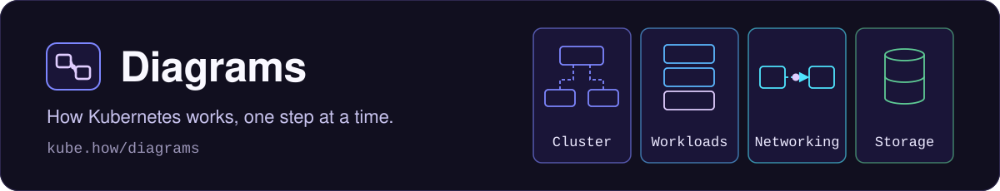
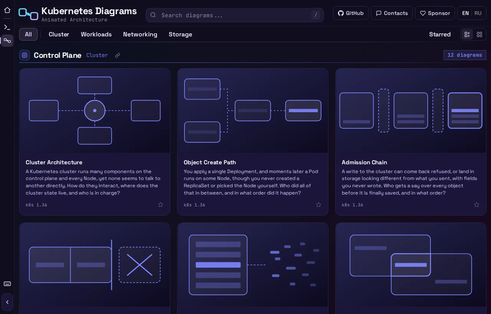

<p align="center">
  <a href="https://kube.how/diagrams/"></a>
</p>

Половина [kube.how](https://kube.how/) с диаграммами. Это анимированные диаграммы того, как Kubernetes на самом деле работает внутри. Каждая карточка открывает окно, где механизм проигрывается по шагам. Панель с пояснением рассказывает, что движется и почему, а рядом стоят ссылки на документацию Kubernetes, по которой собрана диаграмма. Сайт работает на **[kube.how/diagrams](https://kube.how/diagrams/)**.

[← Назад к главному README](../README.ru.md) · [English](./README.md)

<p align="center">
  
</p>

## Что здесь есть

| Категория | Цвет | Разделы |
|---|---|---|
| **Cluster** | индиго | Control Plane, Node Runtime, Node Lifecycle |
| **Workloads** | небесно-голубой | Pods Bootstrap, Pods Lifecycle, Controllers |
| **Networking** | бирюзовый | Network Foundations, Pod Networking, Services & Endpoints, External Traffic, DNS & Service Discovery |
| **Storage** | нефритовый | Volume Foundations, Volumes & Claims, CSI & Mount Path, Stateful Data |

Каждая карточка сверена с релизом Kubernetes, который на ней указан (`k8s 1.36`), и ссылается на свои источники. У каждой диаграммы есть и своя статическая страница, например [kube.how/diagrams/card/cluster-architecture/](https://kube.how/diagrams/card/cluster-architecture/). На ней постер, полное пошаговое объяснение и источники, и читается она на любом экране. Полный список лежит на [kube.how/diagrams/card/](https://kube.how/diagrams/card/).

## Как пользоваться

- **Кликните по карточке**, чтобы открыть её диаграмму. Сначала показывается неподвижный постер, потом начинается первый шаг.
- **Листайте диаграммы**, не закрывая окно, боковыми стрелками или клавишами `Shift` + `←` / `→`.
- **Отметьте диаграмму звёздочкой** на карточке или в открытом окне, и она попадёт в вид Starred.
- **Сообщите об ошибке** прямо из диаграммы. Кнопка с флажком открывает issue на GitHub, где уже указаны карточка и шаг, на котором вы остановились.
- **Сохраните для слайдов** через кнопку загрузки в шапке окна. Можно взять текущий шаг как PNG или всю анимацию как GIF.
- **Два вида сетки**. Подробные карточки с полным описанием или компактные плитки, которых на экран помещается в три-пять раз больше. Переключатель стоит в правом конце ряда категорий, и выбор запоминается.
- **Поиск и фильтр** по категории или по названиям и описаниям. Диаграммы, появившиеся с вашего прошлого визита, помечены значком `NEW`, пока вы их не откроете.
- **Ссылки на диаграмму**. `kube.how/diagrams/#diagram=<id>` открывает диаграмму, а адрес следит за текущим шагом, так что им можно поделиться как есть. Значок ссылки рядом с названием раздела копирует `kube.how/diagrams/#at=<section>`.
- **Английский или русский**. Кнопка языка в правом конце шапки переключает описания карточек, кнопки окна и пояснения. Подписи внутри диаграммы остаются английскими, как в документации Kubernetes.
- **Уменьшенная анимация** учитывается. При `prefers-reduced-motion` каждый шаг сразу встаёт в конечное состояние.
- **Сначала десктоп**. На телефоне страница показывает короткое сообщение со ссылкой на статические страницы, которые нормально читаются на любом экране.

### Клавиатура

| Клавиша | Действие |
|---|---|
| `Space` | Пуск или пауза |
| `←` / `→` | Предыдущий или следующий шаг |
| `Shift` + `←` / `→` | Предыдущая или следующая диаграмма |
| `R` | Начать заново |
| `L` | Повтор по кругу |
| `F` | Полный экран |
| `Esc` | Закрыть диаграмму или очистить поиск в каталоге |
| `Enter` | Открыть карточку в фокусе |
| `/` | Перейти к поиску |
| `?` | Показать все сочетания клавиш |

Буквенные клавиши работают и в русской раскладке.

## Как это устроено

Каждая диаграмма нарисована вручную в SVG и двигается через Web Animations API внутри нативного `<dialog>`. Никаких библиотек для диаграмм, canvas, WebGL и шага сборки.

```
diagrams/
  index.html
  js/app.js                    сетка и маршрутизация по #
  js/dialog.js                 окно карточки, его плеер и клавиши
  js/data.js                   реестр категорий и четыре каталога карточек
  js/posters.js                четыре набора постеров, собранные вместе
  js/lib/                      SVG-помощники, примитивы, таймлайн, движение, токены раскладки, экспорт PNG и GIF
  js/lang/                     русские описания и пояснения, загружаются только при включённом русском
  js/diagrams/<category>/      по папке на категорию
    cards.js                     каталог с id, названием, описанием, версией и источниками
    posters.js                   миниатюры для сетки
    <category>-kit.js            цвет категории и помощники для рисования
    <id>.js                      по модулю на диаграмму
  css/                         токены (цвета категорий), раскладка, SVG-классы, статические страницы
  card/                        сгенерированные статическая страница и SVG постера на каждую диаграмму (результат сборки, в git не лежат)
  test/                        набор тестов (на сайт не попадает)
  CANON.md                     свод правил, которым обязана следовать каждая диаграмма
```

### Диаграмма это данные

Каждый `<id>.js` загружается только при открытии своего окна и экспортирует сцену, её шаги и `init`, собранный из них.

```js
export const SCENE = {
  'aria-label': '...',
  parts: [ /* boxes, lanes, pods, chips, in z-order */ ],
};
export const STEPS_SPEC = [
  {
    id: 'api',
    duration: 3600,
    narration: 'The API is the only way in for clients and controllers...',
    flow: [ /* balls, tags, pulses, fades */ ],
  },
];
export const init = defineCard(SCENE, STEPS_SPEC, { posterFirst: true });
```

`SCENE.parts` рисует картинку по порядку. Каждый шаг задаёт свои подписи и значения, а его `flow` описывает движение и проигрывается в порядке списка. Шарик едет по линии, везёт свою метку и подсвечивает Pod, в который прилетает. Те же шаги управляют режимом уменьшенной анимации и текстом статической страницы карточки.

## Как добавить диаграмму

Новая диаграмма меняет одну папку внутри `js/diagrams/<category>/`. Сначала прочитайте [`CANON.md`](./CANON.md) и уже готовые карточки этой папки. Стройте на её `<category>-kit.js` и берите за основу форму готового образца, а не начинайте с нуля.

1. Напишите `<id>.js`. Id начинается с категории, например `network-dns-coredns`. Под импортами должен стоять ровно один комментарий со ссылкой на собственную запись карточки, `// Design notes for this card: ./CARDS/<id>.md`. Если скопировать образец целиком, в нём останется ссылка образца, и проверка такую карточку не пропустит.
2. Напишите эту запись, `CARDS/<id>.md`, по образцу соседних. В ней сказано, что показывает карточка и какое правило она нарушает намеренно.
3. Добавьте её в `cards.js` с названием, подразделом, описанием из трёх предложений, версией Kubernetes и источниками.
4. Нарисуйте её постер для сетки в `posters.js`.
5. Сгенерируйте статическую страницу и запись в sitemap, затем запустите проверки. Генератор заодно обновляет `js/revisions.js` и `tools/pages/dates.json`, их коммитят вместе с карточкой.

```bash
node tools/pages/build.mjs                  # из корня репозитория
python3 -m http.server 8888                 # из корня репозитория, во втором терминале
cd diagrams/test && npm ci && npx playwright install chromium
npm test                                    # unit-тесты и проход браузера по каждому шагу
```

`DIAGRAM_IDS=<id> npm test` сужает проход браузера до одной карточки, пока вы над ней работаете, а `npm run docs:sync` обновляет цифры в главном README. После этого посмотрите на саму диаграмму в браузере. Линия, которая обрывается в пустоте, или подпись, уехавшая от своего шарика, не видны ни одной проверке. Если добавить `?inspect=1` к адресу страницы, поверх диаграммы появится координатная сетка.
